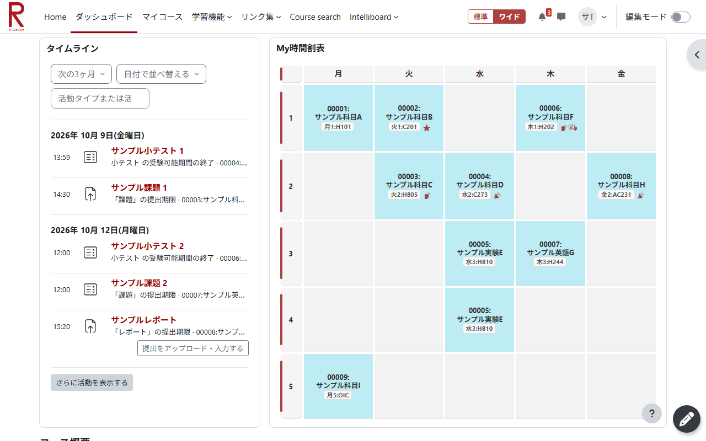

# Assist for moodle+R

立命館大学の LMS「moodle+R」を、パソコンで使いやすくする Chrome / Edge 拡張機能です。
開いた瞬間に、締め切りの近い課題と今週の時間割が1画面にそろいます。
Chrome ウェブストア: https://chromewebstore.google.com/detail/lgofkcacddfpoepkfiabigmiihmflppn?utm_source=item-share-cb

> **非公式**の拡張機能です。立命館大学とは関係ありません。



## できること

- **時間割と課題を1画面に**: ダッシュボードを画面幅いっぱいに広げ、左に課題、右に時間割を並べます。
- **コースページを広く見やすく**: 授業のページの第1回・第2回…を2列で並べます。
- **標準 | ワイド の切り替え**: いつでも moodle+R 本来の表示に戻せます。
- **シラバスをワンクリックで**: 授業のページの「シラバス」ボタンから、その授業のシラバスを開きます。
- **教材を一括ダウンロード**: 授業の教材を回ごとの一覧から選び、まとめて保存できます。
- **先生にすぐメッセージ**: 「私の先生にメッセージ」を授業のページの上部に表示します。
- **Home を飛ばす**: ブックマークから開くと、ダッシュボードが直接開きます。
- **リンク集に CAMPUS WEB**: ナビバーのリンク集から CAMPUS WEB を開けます。

詳しい使い方は、利用者向けの [使い方ガイド](extension/README.md) を見てください。

## インストール

インストールは[こちら](https://chromewebstore.google.com/detail/lgofkcacddfpoepkfiabigmiihmflppn?utm_source=item-share-cb)から。
ここでは、GitHub から入れる方法を説明します。

### 1. ダウンロードして展開する

1. このページ右側の **Releases** を開き、最新版の **Assets** にある `assist-for-moodle-r-v○○.zip` をダウンロードします。
2. zip を右クリックして「すべて展開」し、できたフォルダを **消さない場所** に置きます。
   - おすすめ: `ドキュメント\Assist for moodle+R`
   - インストール後にこのフォルダを移動・削除すると、拡張機能が動かなくなります。

> 緑色の「Code」→「Download ZIP」でダウンロードした場合は、展開した中の **`extension` フォルダ** を使ってください。

### 2. ブラウザに読み込む

| 手順 | Google Chrome | Microsoft Edge |
| --- | --- | --- |
| 1. 拡張機能の画面を開く | アドレスバーに `chrome://extensions` | アドレスバーに `edge://extensions` |
| 2. デベロッパーモードをオン | 右上のスイッチ | 左側のスイッチ |
| 3. 読み込む | 「パッケージ化されていない拡張機能を読み込む」 | 「展開して読み込み」 |
| 4. フォルダを選ぶ | 手順1で置いたフォルダ（`manifest.json` が入っているフォルダ） | 同左 |

読み込むと、使い始めの案内ページが開きます。案内にしたがって、moodle+R のダッシュボードを一度開けば準備完了です。

> ブラウザの起動時に「デベロッパーモードの拡張機能を無効にする」という案内が出ることがあります。無効にせずに閉じてください。

### 3. 更新する

1. Releases から新しい zip をダウンロードして展開します。
2. **前と同じフォルダ** の中身を、新しいものに置き換えます。
3. 拡張機能の画面（`chrome://extensions`）で、この拡張機能の再読み込みボタン（↻）を押します。

同じフォルダを使えば、保存してあるシラバスの URL や表示の設定はそのまま引き継がれます（フォルダの場所が変わると、別の拡張機能として扱われて設定が消えます）。

## フォルダ構成

```
├ extension/        拡張機能の本体（このフォルダを読み込む）
│  ├ manifest.json            設定（権限・対象の URL・バージョン）
│  ├ layout-toggle.js/.css    「標準 | ワイド」の切り替え
│  ├ dashboard.css            ダッシュボードの2列表示と時間割
│  ├ course.css               コースページの2列表示と各ボタン・ダイアログ
│  ├ course-syllabus.js       シラバスボタン
│  ├ syllabus-search.js       シラバスサイトでの自動検索
│  ├ materials-download.js    教材の一括ダウンロード（教材を集めて一覧を表示）
│  ├ background.js            教材の保存・フォルダ分け・案内ページの表示
│  ├ course-teachers.js       「私の先生にメッセージ」を上部に表示
│  ├ home-skip.js             Home を飛ばしてダッシュボードへ
│  ├ campusweb-link.js        リンク集に CAMPUS WEB を追加
│  ├ timetable-courses.js     時間割から授業コードを覚える
│  ├ welcome.html/.css/.js    インストール直後の案内ページ
│  └ README.md                利用者向けの使い方ガイド
├ docs/
│  ├ architecture.md        仕組みと設計（コードを読む人・手を入れる人向け）
│  └ testing.md             公開前の動作確認チェックリスト
├ CHANGELOG.md      変更履歴
├ assets/           Chrome ウェブストア用の画像と説明文（すべてサンプルデータ）
├ PRIVACY.md        プライバシーポリシー
└ .github/workflows/release.yml   リリース用 zip の自動作成
```

## 開発

- ビルドは不要です（素の JavaScript と CSS、Manifest V3）。
- コードを変えたら、拡張機能の画面で再読み込み（↻）して確かめます。
- 仕組みや設計の判断は [docs/architecture.md](docs/architecture.md) にまとめています。
- 新しいバージョンを公開する前に、[docs/testing.md](docs/testing.md) のチェックリストで実際の moodle+R で確認します。
- 変更内容は [CHANGELOG.md](CHANGELOG.md) に追記します。

## プライバシー

利用者の情報を外部に送信することはありません。詳しくは [PRIVACY.md](PRIVACY.md) を見てください。
