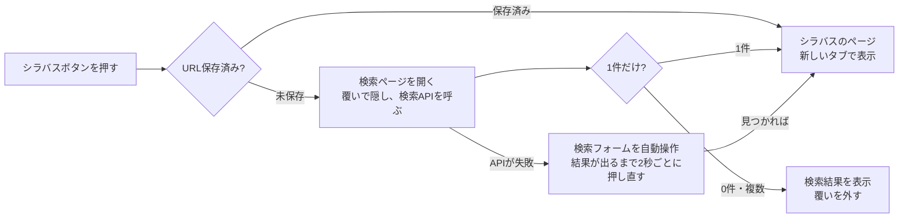

# 仕組みと設計

Assist for moodle+R がどう動いているかをまとめた資料です。
使い方は [利用者向けガイド](../extension/README.md)、変更の履歴は [CHANGELOG.md](../CHANGELOG.md) を見てください。

## 全体像

- Chrome / Edge 拡張機能（Manifest V3）。ビルドは不要で、素の JavaScript と CSS だけで書いています。
- 動作するのは `lms.ritsumei.ac.jp`（moodle+R）と `syllabus.ritsumei.ac.jp/syllabus/s/`（オンラインシラバス）だけです。
- 見た目の変更は CSS だけで行い、ボタンなどの追加はコンテンツスクリプトで行います。
- 外部への送信はしません。ブラウザ内に保存するのは3種類の情報だけです（[保存するデータ](#保存するデータ)）。

## 前提にしている moodle+R の構造

moodle+R は **Moodle 4.5**（テーマは標準の Boost）で動いています。拡張機能が頼りにしている HTML の構造は、Moodle 4.5 の公式ソース（`MOODLE_405_STABLE`）で確認しています。

| 拡張機能の前提 | Moodle 4.5 の実装 |
| --- | --- |
| 左右の余白は `body.limitedwidth #page.drawers .main-inner { max-width: 830px }` | `course/view.php`・`course/section.php`・ダッシュボードで `limitedwidth` が付く |
| ダッシュボードのブロックは `#block-region-content` の直下に並ぶ | ブロック領域の標準構造 |
| 教材は `li.activity.modtype_<種類>`、名前は `data-activityname`、リンクは `a.aalink` の中の `.instancename` | `course/format/templates/local/content/cm*.mustache` |
| 回は `li.section`、名前は `.sectionname`、番号は `data-number` | `course/format/templates/local/content/section*.mustache` |
| 回の一覧は `.course-content ul.topics` / `ul.weeks` | `content.mustache`: `<ul class="{{format}}">` |
| 回ごとのページは `course/section.php` | Moodle 4.4 以降の標準 |
| フォルダの中身は `pluginfile.php/…/mod_folder/content/<版>/<パス>` | `mod/folder/renderer.php` |
| 「ファイル」は `mod/resource/view.php?id=…&redirect=1` でファイル本体へ転送される | `mod/resource/view.php`（編集権限のある人には転送されない） |

大学独自の部分:

- 「My時間割」は大学独自のブロック `block_rutime_table`。元の CSS が高さを 500〜700px に制限して内部スクロールさせているため、ワイド表示ではこれを外して詰めています。
- 科目名は `12345:科目名(クラス)` の形で、先頭の5桁が授業コードです。合同開講は `12345:… § 12346:…` のように複数入ります。
- 「私の先生にメッセージ」は追加プラグイン `block_messageteacher`（Message My Teacher）で、右側のドロワーにあります。

## 機能ごとの仕組み

### ワイド表示（`layout-toggle.js` / `dashboard.css` / `course.css`）

- `layout-toggle.js` が読み込み開始時に `<html>` に `data-mx-dashboard="wide"` / `data-mx-course="grid"` を付け、CSS はこの属性があるときだけ効くように書いています。「標準」を選ぶと属性の値を `default` にするだけなので、再読み込みは不要です。
- 選んだ表示は `chrome.storage.local` の `layout` に保存します。ちらつきを防ぐため、保存値を読む前に既定（ワイド）を付けておきます。
- 画面幅 1200px 未満と、編集モード（`body.editing`）のときは効かないようにしています。
- ダッシュボードは CSS Grid で左にタイムライン、右に時間割を置きます。タイムラインと時間割の両方のブロックがあるときだけ2列にします（`:has()` で判定）。
- 時間割は、授業のない最終時限の行と土曜日の列を `:has()` で判定して隠します。

### シラバスを開く（`course-syllabus.js` / `syllabus-search.js` / `timetable-courses.js`）

シラバスの授業ページの URL は `/syllabus/s/r-syllabus/{レコードID}/{年度}{授業コード}` で、レコード ID はランダムです。授業コードだけでは URL を作れないため、シラバスサイトの検索を使って求めます。

- 授業コードは、コースページの見出しから読み取ります。見出しにない場合は、ダッシュボードで `timetable-courses.js` が覚えた「コース ID → 授業コード」の対応を使います。
- 検索ページは `?language=ja#mx-syllabus=<授業コード>&year=<年度>` 付きで開き、`syllabus-search.js` が読み込み開始時に覆いを出して途中の画面を隠します。
- シラバスサイトの検索画面は、内部で `getSyllabusRecords`（Salesforce の Aura API）を1回呼んでいます。これを**シラバスサイトのページ内から**同じ形で呼び、結果のレコード ID から URL を組み立てます。通常は約1.5秒で開きます。
- 見つけた URL は `syllabusUrls` に保存し、次回からボタンのリンク先を直接その URL にします。
- 年度は4月始まりで計算します（1〜3月は前年度）。

設計上の判断:

- この API は、送信元（Origin）がシラバスサイト以外の通信を 401 で拒否します。拡張機能の service worker から呼ぶと拒否されるため、ページ内から呼んでいます。送信元を書き換えて回避することは、大学側の防御を破ることになるので行いません。
- シラバスサイトは他のページへの埋め込みを禁止している（`X-Frame-Options: SAMEORIGIN`）ため、ダッシュボード内には表示せず、新しいタブで開きます。
- 画面の部品（LWC）はページ自身のスクリプトからは見えませんが、拡張機能のスクリプト（isolated world）からは操作できます。API が使えないときの予備として、検索フォームを自動操作します。表示直後はフォームの準備が終わっていないことがあるため、結果が出るまで押し直します。

### 教材の一括ダウンロード（`materials-download.js` / `background.js`）

**集める（`materials-download.js`、コースページ）**

| 対象 | 方法 |
| --- | --- |
| 「ファイル」 | `mod/resource/view.php?id=…` に `redirect=1` を付ける |
| 「フォルダ」 | コースページに中身が表示されていればそのリンクを、なければフォルダのページを取得して `mod_folder/content` のリンクを拾う。URL からサブフォルダを読み取る |
| 説明文・ラベルの添付 | `pluginfile.php` へのリンクを拾う |
| 「ページ」の添付 | ページを取得して本文の `pluginfile.php` へのリンクを拾う |
| 「課題」の資料 | 課題のページを取得し、`mod_assign` の `introattachment`（追加ファイル）と `intro`（説明文に貼られたファイル）だけを拾う。同じページに出る提出ファイル（`assignsubmission_*`）とフィードバック（`assignfeedback_*`）は集めない。提出を受け付けている（課題のページに「提出を追加／編集」がある）ときは提出画面（`action=editsubmission`）も取得し、「提出中のみファイルを表示する」設定の追加ファイルと、「活動の指示」に貼られたファイル（`activityattachment`）も拾う。時間制限付き課題のタイマーを始める `begin=1` は付けない |
| 回ごとのページ | コースページに教材が出ていない回は `course/section.php` を取得し、上と同じように拾う |

- 取得は同じサイト内の `fetch` なので、ログイン状態のまま読めます。同じファイルは `forcedownload` の有無を無視して1回だけ数えます。
- 一覧はコースページ上の並び順に並べ、回ごとに見出しを付けます。

**保存する（`background.js`、service worker）**

- `chrome.downloads` はコンテンツスクリプトから使えないため、ダイアログから `chrome.runtime.connect` で依頼を送り、service worker が順番待ちの列に積んで1件ずつ保存します。ダイアログを閉じても、ページを移動しても保存は続きます。
- 保存先は `chrome.downloads.onDeterminingFilename` で決めます。この拡張機能が始めたダウンロード（`byExtensionId`）だけを振り分け、ほかのダウンロードには関与しません。
- 保存先のフォルダは、選んだ教材に応じてダイアログ側で決めます。

  | 選んだ教材 | 保存先 |
  | --- | --- |
  | 1件 | `ダウンロード/<ファイル名>` |
  | 2件以上・同じ回 | `ダウンロード/<回>/[<フォルダ教材>/<サブフォルダ>/]<ファイル名>` |
  | 2件以上・複数の回 | `ダウンロード/<科目>/<回>/[<フォルダ教材>/<サブフォルダ>/]<ファイル名>` |

- 保存が終わるたびに `finalUrl` を確かめ、ログイン画面（ログイン切れ）や `mod/resource/view.php`（編集権限のある人には転送されない）だった場合は、教材ではない HTML を保存したと判断して削除し、失敗として知らせます。
- 残り件数は拡張機能アイコンのバッジに表示します。保存中は20秒ごとに軽い API を呼び、service worker が止められないようにしています。

### そのほかの機能

- **先生へのメッセージ（`course-teachers.js`）**: 右ドロワーの `block_messageteacher` の先生のリンクを、コースページ上部にボタンとして複製します。プラグインのスクリプトは読み込み時にあったリンクにだけクリック処理を付けるため、複製したボタンは「元のリンクをクリックしたこと」にして、同じメッセージ入力画面を開きます。
- **Home のスキップ（`home-skip.js`）**: サイトのトップ（`/`・`/index.php`）を開いたとき、直前のページ（`document.referrer`）が moodle+R の中でなければ `/my/` に移動します。ナビバーの「Home」やロゴは `/` を指しているため、直前のページで「意図して Home を開いたか」を判断しています（ログイン画面からの移動は外から来たものとして扱います）。
- **CAMPUS WEB（`campusweb-link.js`）**: リンク集の「学び支援サイト」のリンクを複製して、その直後に置きます。PC 用と狭い画面用の両方のメニューに入ります。
- **案内ページ（`welcome.html`）**: 初めてインストールしたとき（`runtime.onInstalled` の `reason` が `install`）だけ開きます。

## 保存するデータ

`chrome.storage.local` に保存するのは次の3つだけです。外部には送りません。

| キー | 内容 | 使い道 |
| --- | --- | --- |
| `syllabusUrls` | `{ "<年度><授業コード>": シラバスの URL }` | 2回目からシラバスをすぐ開く |
| `courseCodes` | `{ "<コース ID>": ["<授業コード>", …] }` | 見出しに授業コードがないコースでシラバスボタンを出す |
| `layout` | `{ dashboard: "wide" \| "default", course: "grid" \| "default" }` | 「標準 \| ワイド」の選択を覚える |

## ファイルと実行タイミング

| ファイル | 対象 | 実行タイミング | 役割 |
| --- | --- | --- | --- |
| `manifest.json` | — | — | 設定。権限は `storage` と `downloads` |
| `background.js` | — | service worker | 教材の保存とフォルダ分け、案内ページを開く |
| `home-skip.js` | `/`、`/index.php` | 読み込み開始時 | Home のスキップ |
| `layout-toggle.js` / `.css` | `/my/*`、`/course/view.php*` | 読み込み開始時 | 「標準 \| ワイド」の切り替え |
| `campusweb-link.js` | moodle+R の全ページ | 読み込み完了後 | リンク集に CAMPUS WEB を追加 |
| `dashboard.css` | `/my/*` | 読み込み開始時 | ダッシュボードのワイド表示 |
| `timetable-courses.js` | `/my/*` | 読み込み完了後 | 時間割から授業コードを覚える |
| `course.css` | `/course/view.php*` | 読み込み開始時 | コースページのワイド表示、ボタン、ダイアログ |
| `course-syllabus.js` | `/course/view.php*` | 読み込み完了後 | シラバスボタン |
| `materials-download.js` | `/course/view.php*` | 読み込み完了後 | 教材を集めて一覧ダイアログを表示 |
| `course-teachers.js` | `/course/view.php*` | 読み込み完了後 | 先生へのメッセージボタン |
| `syllabus-search.js` | シラバスサイト | 読み込み開始時 | 自動検索と URL の保存 |
| `welcome.html` / `.css` / `.js` | — | インストール時 | 使い始めの案内ページ |

コースページでは、`course-syllabus.js`・`materials-download.js`・`course-teachers.js` の3つが見出しの下のボタン並び（`.mx-course-syllabus`）を共有します。`course-syllabus.js` は storage の読み込みを待つ間に後のスクリプトが並びを作ることがあるため、並びがすでにあればそれを使い、シラバスボタンを先頭に入れます。

## 閲覧の記録について

教材を集めるときに「ページ」「フォルダ」「課題」と課題の提出画面を取得するため、利用者が自分で開いたときと同じイベントが Moodle に記録されます（`course_module_viewed`、提出画面では `submission_form_viewed`）。完了条件が「閲覧」の活動は完了になることがあります。提出の記録は作られず（`get_user_submission($userid, false)`）、提出の状態も変わりません。

## 既知の制約

- シラバス検索の API は大学が公開している仕様ではありません。使えなくなった場合も、検索フォームの自動操作で開けます（約4秒）。
- 1〜3月に検索フォームの年度の初期値が拡張機能の計算と違うと、フォームの自動操作ではシラバスが見つからず、検索結果で止まることがあります。
- ワイド表示はトピック形式・週形式のコースだけに効きます。ほかの形式では崩れず、標準の表示のままです。
- 回ごとのページ（`course/section.php`）には、シラバス・一括ダウンロード・先生へのボタンは表示しません。
- 大学がテーマや「My時間割」を改修すると、部品の名前が変わって一部の機能が効かなくなる可能性があります。
